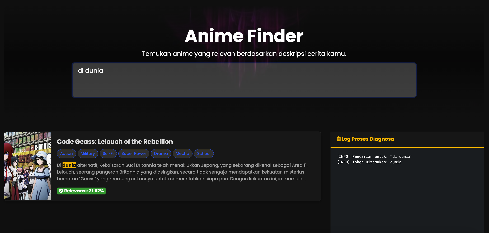

# Sistem Pencarian Genre Anime dengan VSM (Vector Space Model)


Proyek ini adalah sebuah aplikasi web yang mengimplementasikan sistem pencarian anime berdasarkan kemiripan sinopsis menggunakan metode **Vector Space Model (VSM)** untuk Information Retrieval. Pengguna dapat mengetikkan deskripsi cerita, dan sistem akan menampilkan daftar anime yang paling relevan berdasarkan analisis teks sinopsis.

---

## ✨ Tampilan (Screenshot/Demo)



Tampilan antarmuka aplikasi pencarian untuk pengguna.

---

## ✨ Fitur Utama

### Untuk Pengguna (User)
* **Pencarian Live Search:** Hasil pencarian muncul secara dinamis saat pengguna mengetik, tanpa perlu me-refresh halaman.
* **Pencarian Berbasis Sinopsis:** Mencari anime berdasarkan kemiripan cerita, bukan hanya judul.
* **Skor Relevansi:** Setiap hasil pencarian ditampilkan dengan skor kemiripan dalam bentuk persentase.
* **Tampilan Modern:** Antarmuka yang bersih, responsif, dan menarik secara visual dengan tema gelap.
* **Highlight Kata Kunci:** Kata kunci dari pencarian akan ditandai pada sinopsis hasil pencarian.

### Untuk Administrator
* **Dashboard Informatif:** Menampilkan statistik kunci seperti total anime, jumlah kata unik di kamus VSM, dan total pengguna.
* **Manajemen Data Anime (CRUDS):** Fitur lengkap untuk menambah, melihat, mengedit, dan menghapus data anime.
* **Panel Kontrol Indexing VSM:** Halaman khusus untuk membangun atau memperbarui "otak" mesin pencari dengan satu kali klik.
* **Manajemen Aturan Preprocessing:** Kemampuan untuk mengelola *stopwords*, aturan *stemming* (awalan & akhiran), dan tanda baca melalui antarmuka admin.
* **Log Proses:** Tampilan log yang detail saat proses *indexing* berjalan untuk memonitor aktivitas sistem.

---

## 🔧 Teknologi yang Digunakan
* **Backend:** PHP
* **Database:** MySQL / MariaDB
* **Frontend:** HTML, CSS, JavaScript
* **Library:**
    * Bootstrap 4 (Template & Styling)
    * jQuery (AJAX & DOM Manipulation)
    * DataTables (Tabel data di admin panel)
    * Highcharts (Grafik di dashboard admin)
    * SweetAlert2 (Notifikasi)

---

## 🚀 Instalasi dan Konfigurasi

Ikuti langkah-langkah berikut untuk menjalankan proyek ini di lingkungan lokal Anda.

### 1. Prasyarat
* Pastikan Anda memiliki web server seperti **XAMPP** atau **MAMP** yang sudah terpasang (dengan PHP & MySQL).

### 2. Clone Repository
* Buka terminal atau Git Bash, arahkan ke direktori web server Anda (`htdocs` untuk XAMPP, `htdocs` untuk MAMP), dan jalankan perintah:
    ```bash
    git clone [URL_REPOSITORY_GITHUB_ANDA] anime_vsm
    ```

### 3. Setup Database
* Buka **phpMyAdmin**.
* Buat database baru dengan nama `db_vsm_anime`.
* Impor file `.sql` yang berisi struktur dan data awal (seperti data aturan teks) ke dalam database `db_vsm_anime`.

### 4. Konfigurasi Koneksi
* Buka file `koneksi.php` (atau `functions.php`, sesuaikan dengan nama file koneksi Anda).
* Sesuaikan detail koneksi database:
    ```php
    $servername = "localhost";
    $username = "root";
    $password = ""; // atau "root" untuk MAMP
    $dbname = "db_vsm_anime";
    ```

### 5. Jalankan Aplikasi
* Pastikan Apache dan MySQL di XAMPP/MAMP Anda berjalan.
* Aplikasi siap diakses melalui URL berikut:

    * **Halaman Pengguna:**
        ```
        http://localhost/anime_vsm/
        ```
    * **Halaman Admin:**
        ```
        http://localhost/anime_vsm/admin/
        ```

---

## 📚 Alur Kerja Administrator (PENTING!)

Agar mesin pencari berfungsi, admin **wajib** mengikuti alur kerja ini setelah instalasi:

1.  **Login** ke panel admin.
2.  **Lengkapi Aturan Teks:** Buka halaman `Manajemen Aturan Teks` dan pastikan data *stopwords*, *stemming*, dan tanda baca sudah terisi dengan baik.
3.  **Input Data Anime:** Buka halaman `Manajemen Data Anime` dan tambahkan beberapa data anime.
4.  **Jalankan Indexing:** Buka halaman `Proses Indexing VSM` dan klik tombol **"Mulai Proses Indexing Ulang"**. Tunggu hingga selesai.

**Catatan:** Proses *indexing* harus dijalankan ulang setiap kali Anda menambah/mengubah data anime atau mengubah aturan teks agar perubahan tersebut diterapkan pada mesin pencari.

---

## 🔑 Akun Demo Administrator

Gunakan akun berikut untuk masuk ke panel admin.

* **URL Admin:** `http://localhost/anime_vsm/admin/`
* **Username:** `admin`
* **Password:** `admin123`

**Sangat disarankan** untuk mengubah kata sandi default setelah login pertama kali demi keamanan.